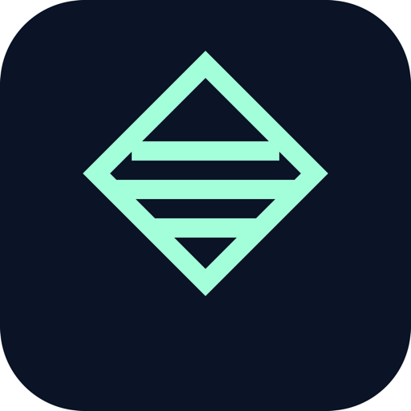
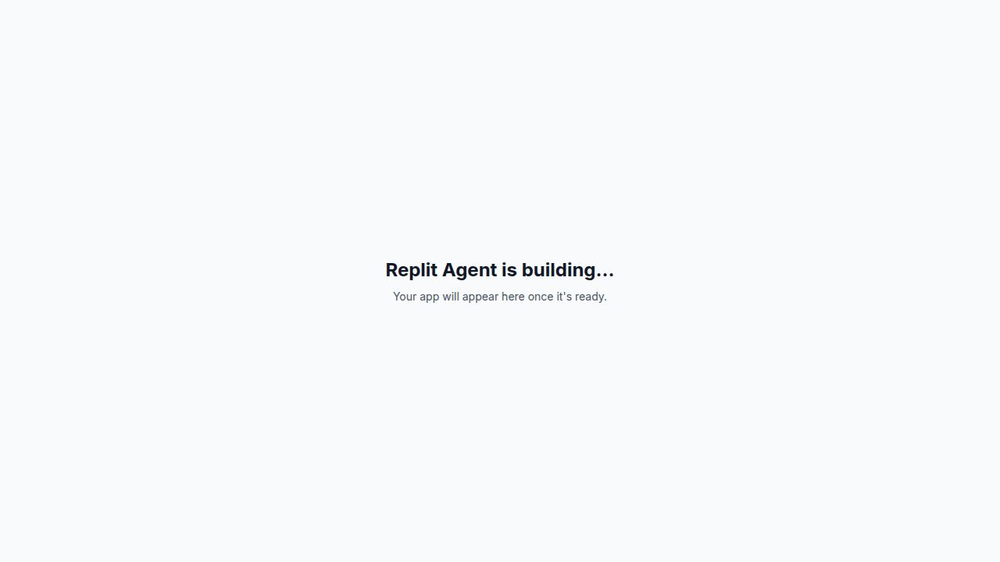

# Token Tracker Dashboard

<div align="center">
  
  <h1>Token Tracker Dashboard</h1>
  <p><strong>The web command center for monitoring AI token usage, provider health, session quality, and team activity.</strong></p>
  <p>
    
    
    
    
  </p>
</div>



## Product Snapshot

Token Tracker Dashboard is the browser-based surface of the Token Tracker product family. It is built for operators, founders, and teams who need a fast view of token spend, latency, model usage, provider reliability, and session-level quality signals.

This repository now contains only the web dashboard. The mobile experience lives in its own companion repository so both products can be iterated, deployed, and versioned independently.

## What The Dashboard Covers

- Spend, token, latency, and throughput visibility
- Provider integrity and health-state monitoring
- Session investigation and triage workflows
- Team leaderboard and usage patterns
- Analytics views for trends, composition, and operational cadence
- Settings and admin surfaces prepared for deeper backend wiring

## Visual Identity

The dashboard and mobile app intentionally share the same product logo so both repos present a unified Token Tracker identity.

- Dashboard logo: [public/logo.png](/Users/hanyramadan/token-tracker-dashboard/public/logo.png)
- Mobile logo: [logo.png](/Users/hanyramadan/token-tracker-mobile/assets/images/logo.png)

## Tech Stack

- React 19
- Vite 7
- TypeScript 5.9
- TanStack Query
- TanStack React Table
- Recharts
- Wouter
- Radix UI
- Tailwind CSS 4

## Project Structure

```text
.
├── public/          # Static assets and brand media
├── src/
│   ├── components/  # Shared UI and chart primitives
│   ├── data/        # Mock data currently driving the dashboard
│   ├── features/    # Page-level product areas
│   ├── hooks/       # Reusable UI hooks
│   ├── lib/         # Filters, auth mock, and utilities
│   ├── pages/       # Route fallbacks
│   └── types/       # Application types
├── index.html
├── package.json
├── vite.config.ts
└── vitest.config.ts
```

## Local Development

```bash
pnpm install
pnpm run dev
```

## Available Scripts

```bash
pnpm run dev
pnpm run build
pnpm run serve
pnpm run typecheck
pnpm run test
```

## Current State

The dashboard has been tested as a standalone app after the repo split and is ready for web deployment. Much of the product is still mock-backed by design, which keeps the repo lightweight for UI iteration, demos, and frontend delivery while backend integration continues separately.

## Deployment

This repository is intended to deploy as a standalone Vite app on Vercel.

- Build command: `pnpm run build`
- Output directory: `dist`
- Node target: `24.x`

## Related Repository

- Mobile companion app: [token-tracker-mobile](https://github.com/Hany-R-Mahmoud/token-tracker-mobile)

## Status

This repo is the canonical web dashboard repository after the refactor and cleanup.
