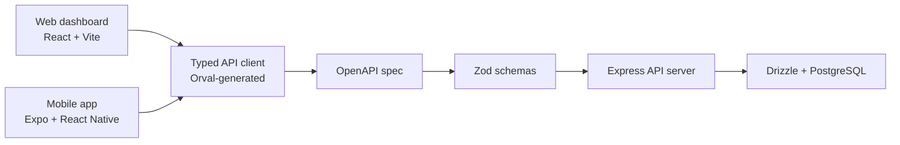

# Token Tracker Dashboard

<div align="center">
  <h1>Token Tracker Dashboard</h1>
  <p><strong>A surface-truth observability workspace for AI usage, spend, session health, and provider integrity.</strong></p>
  <p>
    
    
    
    
    
  </p>
  <p>
    
    
    
  </p>
</div>

---

## Why this repo exists

Modern AI products generate a lot of operational noise: token spikes, fallback chains, degraded providers, cost drift, unreliable sessions, and vague "something feels off" incidents.

Token Tracker turns that noise into a readable operating surface. It is designed to help teams answer questions like:

- Which providers are healthy right now?
- Where are tokens, cost, and latency trending?
- Which sessions need attention?
- How trustworthy is the current output surface?
- Which team members, models, or flows are under pressure?

This repository packages that vision as a multi-app monorepo with:

- a polished **web dashboard** for ops and admin workflows
- a responsive **mobile companion app** for on-the-go visibility
- a typed **API and schema foundation** for future backend integration
- shared workspace tooling for **type safety**, **codegen**, and **database evolution**

---

## What makes it interesting

| Area | Highlights |
| --- | --- |
| Product framing | Built around "surface truth" instead of raw analytics alone |
| Interface style | Dark navy foundation, mint accent, operational typography, semantic health states |
| Monitoring model | Tracks spend, tokens, latency, success rate, truth resolution, context health, and team performance |
| Delivery shape | pnpm monorepo with separate web, mobile, API, DB, schema, and codegen packages |
| Current maturity | Strong UI and interaction prototype, with several controls still intentionally mock-backed |

---

## Visual architecture



---

## Product surfaces

### Web dashboard

The web app lives in `artifacts/token-tracker-web` and is the most complete product surface in the repo today.

**Core sections**

- `Overview`: operational hero metrics, trend charts, integrity lanes, heatmap, investigation log, recent sessions
- `Analytics`: period comparison, provider efficiency, model breakdown, outcome distribution, activity analysis
- `Team`: leaderboard, rank visualization, member trends, detail sheet
- `Sessions`: searchable log, status filtering, composition summary, session drill-in
- `Admin`: provider health, ingestion status, team management, audit log
- `Settings`: profile, display, notification, API key, and system preferences

**Notable implementation details**

- URL-shaped filter logic exists and is wired through shared helpers
- role-based route access is mocked for `admin`, `analyst`, and `viewer`
- charting is built from reusable primitives rather than page-specific one-offs
- tests already cover key web utilities such as filters and auth behavior

### Mobile app

The mobile app lives in `artifacts/token-tracker-mobile` and mirrors the same product identity in an Expo-native form.

**Core screens**

- `Overview`: system status, KPI deck, provider integrity, recent sessions, truth distribution
- `Analytics`: token trends, success analysis, model pressure, provider efficiency, heatmap
- `Team`: searchable leaderboard with detail sheet and trend context

**Design continuity**

- same mint-on-ink visual language as the web app
- same semantic health model across states like `healthy`, `warning`, `critical`, `fallback`, and `unknown`
- mobile-first chart components for concise operational scanning

### API and shared foundation

The repo also includes the pieces needed to move from mock-backed UI into a fully typed product stack:

- `artifacts/api-server`: Express 5 service with typed route validation
- `lib/api-spec`: OpenAPI source of truth
- `lib/api-client-react`: generated React-friendly API client
- `lib/api-zod`: generated Zod schemas from the API contract
- `lib/db`: Drizzle ORM and database schema package

---

## Current state

This is an honest snapshot of where the project stands today:

- The **experience layer is strong**. The web and mobile apps already communicate the product vision clearly.
- The **data layer is still mostly mock-backed**. Many screens use realistic fixture data to shape the product before backend wiring is finished.
- Several controls are **presentational for now**. Some toggles, filters, settings, and admin actions are intentionally non-persistent at this stage.
- The repo already has a **typed backend path** prepared through OpenAPI, generated clients, Zod schemas, and Drizzle.

If you are evaluating the repo quickly, the right mental model is:

> polished product prototype + typed platform foundation + clear path to production wiring

---

## Monorepo layout

```text
.
├── artifacts/
│   ├── token-tracker-web/      # React + Vite dashboard
│   ├── token-tracker-mobile/   # Expo mobile app
│   ├── api-server/             # Express API service
│   └── mockup-sandbox/         # UI experimentation sandbox
├── lib/
│   ├── api-spec/               # OpenAPI contract
│   ├── api-client-react/       # Generated API client
│   ├── api-zod/                # Generated validation schemas
│   └── db/                     # Drizzle schema and database layer
├── scripts/                    # Workspace utilities
└── pnpm-workspace.yaml         # Workspace configuration
```

---

## Stack

### Frontend

- React 19
- Vite 7
- TypeScript 5.9
- TanStack Query
- Recharts
- Wouter
- Radix UI primitives
- Tailwind CSS 4 utilities and design tokens

### Mobile

- Expo SDK 54
- React Native 0.81
- Expo Router
- react-native-svg
- react-native-chart-kit

### Backend and tooling

- Express 5
- PostgreSQL
- Drizzle ORM
- Zod
- Orval
- pnpm workspaces

---

## Local development

### Prerequisites

- Node.js `24`
- `pnpm`

### Install

```bash
pnpm install
```

### Root workspace checks

```bash
pnpm run typecheck
pnpm run build
```

### Run the web dashboard

```bash
pnpm --filter @workspace/token-tracker-web run dev
```

### Run the mobile app

```bash
pnpm --filter @workspace/token-tracker-mobile run dev
```

### Run the API server

```bash
pnpm --filter @workspace/api-server run dev
```

### Regenerate typed clients and schemas

```bash
pnpm --filter @workspace/api-spec run codegen
```

---

## Design language

The repo already has a strong visual identity, which is worth preserving as the product matures:

- **Background**: deep navy / ink foundation
- **Accent**: mint green for signal and momentum
- **Tone**: operational, technical, high-contrast
- **Typography**: Space Grotesk, Manrope, Inter, and monospace metrics
- **Health semantics**: explicit states rather than vague status labels

That combination gives the product a monitoring feel without falling into generic enterprise dashboard styling.

---

## What is already working well

- Clear product story across both web and mobile
- Consistent component vocabulary and design language
- Shared health-state semantics across interfaces
- Typed contract direction already established
- Reusable chart and UI primitives instead of page-specific duplication
- Good foundation for future real-time ops, tracing, and provider analytics work

---

## What likely comes next

- Wire filters and settings into real persistence
- Replace fixture data with API-backed queries
- Expand session drill-down into deeper trace and retry visibility
- Connect provider toggles, ingestion records, and audit events to real system state
- Add auth/session infrastructure behind the mocked RBAC layer
- Introduce deployment, environment, and observability documentation as the backend solidifies

---

## Who this is for

This repo will feel especially relevant if you are building:

- AI operations dashboards
- token and cost monitoring tools
- model reliability or provider health consoles
- admin surfaces for multi-provider LLM workflows
- internal visibility tooling for AI-heavy product teams

---

## Repo philosophy

Token Tracker is not trying to be a generic chart gallery. It is shaping a focused operating product for AI systems, where design clarity matters as much as telemetry depth.

The codebase reflects that direction:

- prototype quickly, but keep types strong
- make interfaces believable before wiring everything
- prefer reusable primitives over one-off screens
- build toward a typed contract between UI, API, and database

---

## License

MIT
